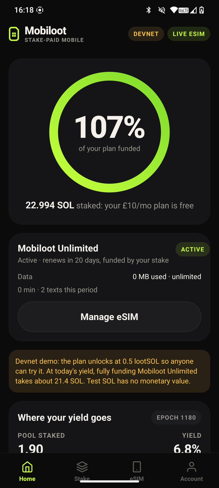
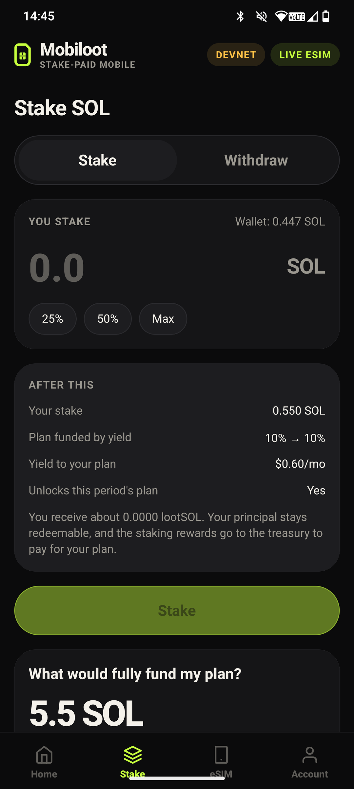
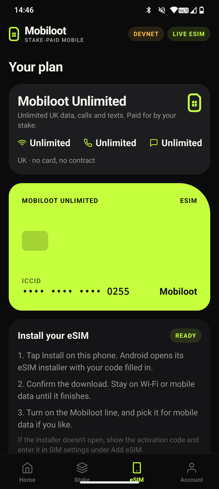
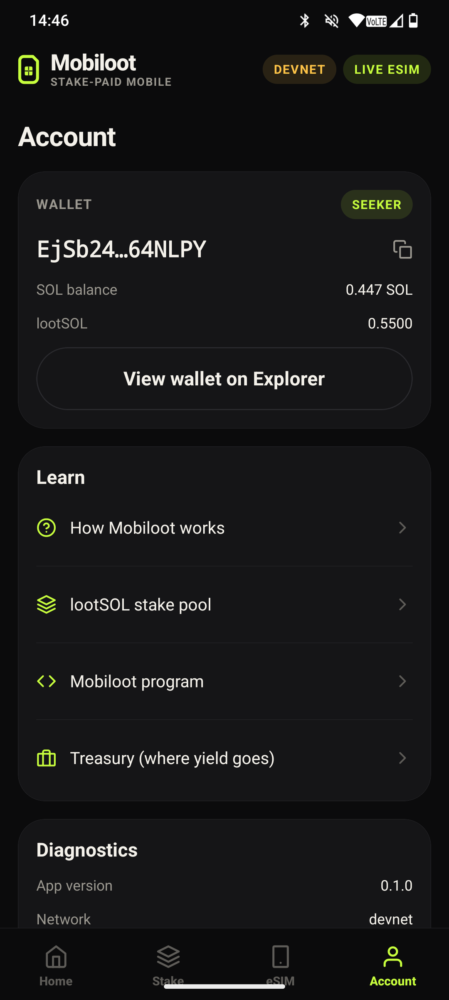

<h1>
  <picture>
    <source media="(prefers-color-scheme: dark)" srcset="logo/mobiloot-wordmark.svg">
    
  </picture>
</h1>

**Stake once. Stay connected.**

**A mobile plan paid for by your staking yield.** Stake SOL, keep your principal,
and let the rewards pay for your phone plan. There's no card and no monthly bill.

Built for **Clock In, the Solana Mobile hackathon**, as an Android-first app for
Seeker and any Android phone with a Mobile Wallet Adapter wallet.

```
stake SOL ──► lootSOL in your wallet ──► rewards go to the treasury ──► plan unlocked on-chain ──► eSIM
```

## Try it in 3 minutes (judges start here)

You need an Android phone (a Seeker is ideal) with a Mobile Wallet Adapter wallet:
the Seeker's own wallet or Phantom.

1. **Install the APK** (`mobiloot-0.1.0.apk`, attached to the submission).
2. **Switch your wallet to devnet.** Mobiloot runs on devnet, so no real money is
   involved. In the Seeker wallet, change the network to Devnet in its settings.
   In Phantom, go to Settings → Developer Settings → Testnet Mode → Solana Devnet.
3. **Get about 0.7 devnet SOL** from [faucet.solana.com](https://faucet.solana.com).
4. **Connect.** Open Mobiloot and tap *Connect wallet*. One approval connects you
   and signs you in.
5. **Stake 0.5 SOL or more** on the *Stake* tab. You'll see how much of the plan
   your stake funds before you sign.
6. **Activate** on the *eSIM* tab. This writes this month's plan to Solana for your
   wallet, and you can view it on Solana Explorer.
7. **Get your eSIM.** Your wallet gets a demo eSIM, marked *Mock eSIM* at the
   top right. Real eSIMs on Shaka's UK network are limited to invited wallets
   while we test, and one is running on our Seeker now (see the demo video).
8. **Withdraw** on the *Stake* tab whenever you like, with no fee. Drop below 0.5
   lootSOL and the line is suspended within a minute; stake again and it resumes.

| Home | Stake | eSIM | Account |
| --- | --- | --- | --- |
|  |  |  |  |

<sub>Captured on a Seeker on 11 Oct 2026, with a live Shaka eSIM and the Seeker wallet on devnet.</sub>

## How it works

1. **Stake.** Deposit SOL into the lootSOL stake pool and get lootSOL back in
   your own wallet. You can redeem it any time with no fee.
2. **Your yield pays.** The pool sends 100% of its staking rewards to the
   Mobiloot treasury, which pays for the plan, so 1 lootSOL stays worth about 1 SOL. You pay with the yield, not
   the principal.
3. **Unlock.** Each billing period, the `mobiloot` program checks your
   lootSOL (valued at the pool's live rate) and writes an entitlement on-chain.
   Nothing personal goes on-chain.
4. **Connect.** The Mobiloot API verifies the entitlement and provisions your eSIM.
   You install it from Android settings using the in-app code, QR code and
   settings shortcut.

The app shows, live, how much of the plan your stake covers and how much stake
would cover all of it, using the pool's measured yield and Pyth's on-chain SOL
price. See [docs/economics.md](docs/economics.md).

## What is real and what is simulated

| | Status |
| --- | --- |
| Wallet connect + sign-in | **Real.** Mobile Wallet Adapter 2.0, Sign In With Solana in one handoff |
| Staking, lootSOL, withdrawals | **Real** SPL stake pool transactions (devnet) |
| Rewards to the treasury | **Real.** 100% epoch fee, minted to the treasury every epoch |
| Plan entitlement | **Real** Anchor program on devnet |
| eSIM | **Real eSIMs** on Shaka's UK network for invited wallets, with one-tap install on Android; a **mock provider** for everyone else and for tests ([docs/esim-provider.md](docs/esim-provider.md)) |
| Money | Devnet SOL has no value. The plan unlocks at 0.5 lootSOL on devnet so anyone can try it |

The app always shows which network and eSIM provider are active.

## Run it

Prerequisites: Node 22, Solana CLI 2.1+, and for the app, an Android device or
emulator with an MWA wallet (Solana's
[fakewallet](https://github.com/solana-mobile/mobile-wallet-adapter/releases)
works on emulators). Anchor 0.31 is only needed to rebuild the program.

### Everything local (no credentials, about 5 minutes)

```bash
npm install
npm run localnet                          # terminal 1: validator with 25 s epochs
CLUSTER=localnet npm run pool:setup       # lootSOL pool with a 100% fee to the treasury
npm run program:build && solana program deploy -ul anchor/target/deploy/mobiloot.so \
  --program-id keys/program/mobiloot-keypair.json   # or restart localnet to preload it
CLUSTER=localnet npm -w ops run setup:program
CLUSTER=localnet npm run api              # terminal 2: API on :8787, mock eSIM provider

cd app && npm install
adb reverse tcp:8787 tcp:8787 && adb reverse tcp:8899 tcp:8899
npm run android                           # builds and installs the debug app
```

Watch rewards reach the treasury: `CLUSTER=localnet npm run pool:status`.

### Devnet

```bash
./scripts/deploy-devnet.sh    # program + pool + config; needs ~4 devnet SOL
CLUSTER=devnet npm run api
EXPO_PUBLIC_API_URL=https://<your-api-host> npm --prefix app run android
```

### Tests

```bash
npm test          # client/IDL checks, localnet end-to-end (if running), API
```

The localnet suite covers deposits minting lootSOL 1:1, activation, double
activation, insufficient stake, someone else's token account, wrong period and
full-principal withdrawal. The API suite covers SIWS (replay, forged
signatures, wrong domain or chain, expiry), rate limiting, entitlement gating,
idempotent provisioning under concurrency, outage recovery, activation-code
masking, and suspending a line when its stake is moved away (relay attack).

Against a live deployment, the smoke test runs 39 happy and sad path checks
through the real API and the real programs (sign-in forgery and replay, every
program rejection, eSIM ordering, deposit and withdraw, suspension and resume):

```bash
CLUSTER=devnet API_URL=https://<your-api-host> npm -w ops run smoke
```

## Repository

| | |
| --- | --- |
| [`app/`](app) | Android app (Expo, React Native, MWA) |
| [`anchor/`](anchor) | `mobiloot` program and IDL |
| [`api/`](api) | Backend: SIWS, entitlement checks, eSIM provisioning, pool stats |
| [`shared/`](shared) | Stake pool and program clients shared by all of the above |
| [`ops/`](ops) | Pool setup, epoch crank, rebalance, status |
| [`docs/`](docs) | [Architecture](docs/architecture.md), [economics](docs/economics.md), [threat model](docs/threat-model.md), [eSIM provider](docs/esim-provider.md), [demo script](docs/demo-script.md), [next steps](docs/next-steps.md) |

## Addresses

| | Devnet | Localnet |
| --- | --- | --- |
| `mobiloot` program | `ALt9aMm6fdhbtdRq9ftbdyQGKkFjoimGfRHNEMtHiWcp` | same |
| Stake pool program | `SP12tWFxD9oJsVWNavTTBZvMbA6gkAmxtVgxdqvyvhY` (Sanctum's SPL deployment) | same, preloaded |
| lootSOL pool, mint, treasury | see [`config/devnet.json`](config) | generated by `pool:setup` |

## About

Mobiloot is built by Charlie Newman, created for Clock In in September 2026. It
builds on the Solana Mobile `web3js-expo-minimal` template and the SPL stake
pool program.

Licence: MIT.

Disclosure: live eSIMs come from [Shaka](https://shaka.tel)'s wholesale API,
which is open to any developer. Charlie is a minority
shareholder in Shaka. Mobiloot is an independent personal project and is not
run or funded by Shaka.
